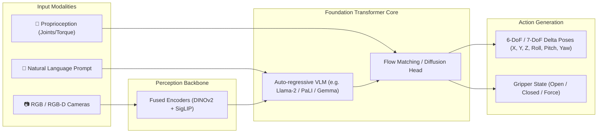

# 🤖 Awesome Vision-Language-Action (VLA) Models

### Curated Ecosystem of Generalist Robot Policies, Embodied AI Foundation Models & Visuomotor Control

  
  
  
  
  
  
  

  <strong>An authoritative, community-driven catalog tracking production SaaS platforms, foundation models, and open-source GitHub repositories for Vision-Language-Action (VLA) architectures and generalist robot policies.</strong>

---

## 📑 Table of Contents

- [🌟 Overview & SEO Taxonomy](#-overview--seo-taxonomy)
- [📊 Sector Overview & Market Dynamics](#-sector-overview--market-dynamics)
- [🏢 Enterprise & SaaS Hosted Platforms](#-enterprise--saas-hosted-platforms)
- [💻 Open-Source GitHub Repositories](#-open-source-github-repositories)
- [🔬 Core VLA Architectural Patterns](#-core-vla-architectural-patterns)
- [🤝 How to Contribute](#-how-to-contribute)
- [💖 Support & Sponsorship](#-support--sponsorship)
- [⭐ Star History](#-star-history)
- [📄 License & Disclaimer](#-license--disclaimer)

---

## 🌟 Overview & SEO Taxonomy

**Vision-Language-Action (VLA)** models form the frontier of **Embodied Artificial Intelligence (Embodied AI)**. By fusing multi-camera visual perception (RGB, RGB-D), large-scale language understanding (LLMs/VLMs), and continuous motor action tokenization, VLA foundation models produce closed-loop control signals (e.g., 6-DoF/7-DoF end-effector delta poses, joint positions, gripper triggers) for real-world robotic manipulators, mobile platforms, and humanoids.

### 🔍 Quick SEO Keywords & Search Index
| Category | Primary Keywords |
|:---|:---|
| **Architectures** | Vision-Language-Action Models, VLA Foundation Models, Generalist Robot Policies, Flow Matching, Diffusion Policies |
| **Pioneering Models** | OpenVLA, π₀ (Physical Intelligence), Octo, RT-2, PaLM-E, Covariant RFM-1, SmolVLA, LeRobot, Skild Brain |
| **Robotics Concepts** | Cross-Embodiment Transfer, Zero-Shot Manipulation, Visuomotor Control, Open X-Embodiment, Bimanual Teleoperation |
| **Frameworks & Simulators** | MuJoCo, Isaac Sim/Lab, SAPIEN ManiSkill, LIBERO, Gymnasium-Robotics, Robomimic, PyBullet |

---

## 📊 Sector Overview & Market Dynamics

The global **Vision-Language-Action (VLA) & Embodied AI software market** is currently valued at approximately **$1.66 Billion to $4.4 Billion** and is projected to surge to **$28 Billion–$41 Billion by 2035**, expanding at a compound annual growth rate (**CAGR of 26% to 39.7%**).

### 📈 Structural Dynamics: High Concentration vs. High Fragmentation
- **Foundational Compute & Model Backbone Tier (Highly Concentrated / Oligopolistic)**: The capital expenditure required for pre-training large multimodal transformer backbones on multi-million trajectory robot datasets (such as Open X-Embodiment) concentrates foundational model weights among hyperscalers and elite frontier labs (**NVIDIA, Alphabet Google DeepMind, Physical Intelligence, Skild AI**).
- **Physical Embodiments & Vertical Applications Tier (Heavily Fragmented)**: End-effector form factors, bimanual mobile bases, humanoid kinematics, industrial pick-and-place lines, and field robotics vary widely across physical environments. This drives widespread vertical specialization and dynamic market competition across specialized system integrators and open-source fine-tuners.

---

## 🏢 Enterprise & SaaS Hosted Platforms

The following enterprise platforms provide commercial VLA models, cloud inference APIs, robot fleet management, and simulation infrastructure. Entries are **sorted descending by company size and market valuation**.

| Platform / Model | Provider / Parent | Company Size & Valuation 🔽 | Starting Tier Pricing | Free Tier / Trial Limit | Key Focus & Primary Capabilities |
|:---|:---|:---:|:---|:---|:---|
| **[NVIDIA Isaac & NIM for Robotics](https://developer.nvidia.com/isaac)** | NVIDIA Corporation | **$3.10 Trillion** (Market Cap) | **$1.00 / GPU-hour** (Pay-as-you-go Cloud Marketplace) or **$4,500 / GPU / year** (NVIDIA AI Enterprise) | **90-Day Free Trial** with 1,000 cloud API / inference credits via NVIDIA Developer Program & `build.nvidia.com` | Project GR00T foundation models for humanoids, GPU-accelerated Isaac Sim/Lab physics, and edge microservices. |
| **[Google Cloud Robotics & Vertex AI](https://cloud.google.com/solutions/robotics)** | Alphabet Inc. (Google DeepMind) | **$2.10 Trillion** (Market Cap) | **$0.075 / 1M multimodal input tokens** + **$0.00013 / action second** (Vertex AI Foundation Model Endpoints) | **90-Day Free Trial** with **$300 cloud credits** + **15 RPM free forever tier** via Google AI Studio | PaLM-E and RT-2 semantic reasoning, Internet-scale multi-task manipulation, and cloud fleet coordination. |
| **[Skild Brain Platform](https://www.skild.ai/)** | Skild AI | **$14.00 Billion** (Valuation, Series C) | **$3,500 / month** (Commercial Developer Pilot Program with SDK & hardware abstraction runtime) | **30-Day Developer Evaluation Trial** with 2,500 cloud simulation rollouts and full SDK simulator access | "Omni-bodied" foundation model controlling humanoids, quadrupeds, and industrial manipulators without per-body training. |
| **[Physical Intelligence π₀ (Pi API)](https://www.physicalintelligence.company/)** | Physical Intelligence | **$5.60 Billion** (Valuation, Series B) | **$2,500 / month** (Pi API Developer Pilot Tier for hosted real-time inference & policy fine-tuning) | **30-Day Developer Pilot Sandbox** with 5,000 API inference calls and open-weight model evaluation access | Generalist Flow Matching VLA trained across 7 robot embodiments for complex household and dexterity tasks. |
| **[Covariant RFM-1 Platform](https://covariant.ai/rfm/)** | Covariant (Amazon Robotics) | **$625 Million** (Valuation / $380M Deal) | **$1,800 / robotic workcell / month** (Production Warehouse Induction & Pick-and-Pack License) | **60-Day Guided Proof-of-Concept (PoC)** supporting up to 2 active robotic cells with real item catalog testing | Multimodal warehouse foundation model combining vision, language, sensor data, and physical anomaly recovery. |
| **[Viam Robotics Platform](https://www.viam.com/)** | Viam Inc. | **$250 Million** (Valuation, Series C) | **$0.01 / GB sync** + **$0.0005 / CPU-sec** ($5.00/month baseline developer commitment) | **Free Forever Tier** with **$5.00/month recurring credits**, unlimited machine connections, and 25 sync actions/day | Cloud-managed robotic fleet operations, streaming telemetry, automated data labeling, and modular ML pipelines. |

---

## 💻 Open-Source GitHub Repositories

The open-source community provides complete architectures for pre-training, fine-tuning, and evaluating VLA policies on consumer and workstation GPUs. Repositories below are **sorted descending by GitHub star count**.

| # | Repository Name | Star Badge (Click to View Stargazers) | Primary Focus & Benchmark Performance |
|:---:|:---|:---:|:---|
| 1 | **[huggingface/lerobot](https://github.com/huggingface/lerobot)** |  | 🤗 Premier Hugging Face robotics library offering end-to-end PyTorch implementations of ACT, Diffusion Policy, and VLA pipelines for low-cost hardware (SO-100, Koch). |
| 2 | **[google-deepmind/mujoco](https://github.com/google-deepmind/mujoco)** |  | ⚡ Multi-Joint dynamics with Contact: the de-facto standard physics engine for robot simulation, reinforcement learning, and VLA benchmark rollouts. |
| 3 | **[Physical-Intelligence/openpi](https://github.com/Physical-Intelligence/openpi)** |  | 🧠 Official open-source release of π₀ (pi-zero), Physical Intelligence’s Flow Matching generalist foundation policy for dexterous bimanual manipulation. |
| 4 | **[openvla/openvla](https://github.com/openvla/openvla)** |  | 🏆 Flagship 7B open-source VLA based on Llama-2 and Prismatic VLMs (DINOv2 + SigLIP). Outperforms RT-2-X with 7× fewer parameters; supports LoRA fine-tuning on consumer GPUs. |
| 5 | **[real-stanford/diffusion_policy](https://github.com/real-stanford/diffusion_policy)** |  | 🌊 Visuomotor policy learning via denoising diffusion processes. Handles multi-modal action distributions with high stability across complex manipulation tasks. |
| 6 | **[mani-skill/ManiSkill](https://github.com/mani-skill/ManiSkill)** |  | 🎮 GPU-parallelized robotics benchmark and simulator built on SAPIEN, delivering 30,000+ FPS simulation for scalable VLA policy evaluation and RL. |
| 7 | **[Lifelong-Robot-Learning/LIBERO](https://github.com/Lifelong-Robot-Learning/LIBERO)** |  | 📚 Benchmark suite for lifelong robot learning and knowledge transfer, evaluating 130+ language-conditioned manipulation tasks across 5 distinct suites. |
| 8 | **[google-deepmind/open_x_embodiment](https://github.com/google-deepmind/open_x_embodiment)** |  | 🌐 Landmark dataset and benchmark consisting of 1M+ real-world robot trajectories across 22 distinct embodiments from 34 academic and industry labs. |
| 9 | **[Farama-Foundation/Gymnasium-Robotics](https://github.com/Farama-Foundation/Gymnasium-Robotics)** |  | 🏋️ Collection of standardized robotic manipulation and locomotion simulation environments maintained by the Farama Foundation. |
| 10 | **[octo-models/octo](https://github.com/octo-models/octo)** |  | 🐙 Transformer-based diffusion policy trained on 800K episodes. Supports language, goal-image conditioning, multi-camera setups, and rapid 30-minute fine-tuning. |
| 11 | **[ARISE-Initiative/robomimic](https://github.com/ARISE-Initiative/robomimic)** |  | 🛠️ Standardized imitation learning and offline RL framework from Stanford and UT Austin featuring standardized metrics and dataset loaders. |
| 12 | **[facebookresearch/home-robot](https://github.com/facebookresearch/home-robot)** |  | 🏠 Meta AI's software stack for Open-Vocabulary Mobile Manipulation (OVMM) across both simulated Habitat environments and real Hello Robot Stretch units. |
| 13 | **[TRI-ML/prismatic-vlms](https://github.com/TRI-ML/prismatic-vlms)** |  | 💎 High-performance, modular vision-language pre-training framework from Toyota Research Institute serving as the vision-language backbone for OpenVLA. |
| 14 | **[huangwl18/VoxPoser](https://github.com/huangwl18/VoxPoser)** |  | 🧭 Zero-shot robot manipulation framework synthesizing 3D value maps from LLMs and VLMs for model-based planning without direct robot demonstration data. |
| 15 | **[NVlabs/mimicgen](https://github.com/NVlabs/mimicgen)** |  | 🧬 Automated demonstration generation system converting a handful of human teleop demos into tens of thousands of varied robot training trajectories. |
| 16 | **[notmahi/dobb-e](https://github.com/notmahi/dobb-e)** |  | 🧹 Open-source household chore learning framework using "The Stick" iPhone teleoperation tool and self-supervised Home Pretrained Representations. |
| 17 | **[lucidrains/pi-zero-pytorch](https://github.com/lucidrains/pi-zero-pytorch)** |  | 🧩 Clean, modular PyTorch implementation of the π₀ Flow Matching foundation architecture by Phil Wang. |
| 18 | **[droid-dataset/droid](https://github.com/droid-dataset/droid)** |  | 🤖 Distributed Robot Interaction Dataset: 76 hours of teleoperated Franka robot manipulation demonstrations across diverse household and industrial rooms. |
| 19 | **[RoboFlamingo/RoboFlamingo](https://github.com/RoboFlamingo/RoboFlamingo)** |  | 🦩 VLA architecture based on OpenFlamingo incorporating Perceiver Resamplers for multi-step temporal reasoning on the CALVIN benchmark. |
| 20 | **[bytedance/GR-1](https://github.com/bytedance/GR-1)** |  | 🎬 Large-scale video generative pre-training for robot manipulation, predicting 6-DoF delta actions and gripper toggles from language commands. |
| 21 | **[rail-berkeley/bridge_data_v2](https://github.com/rail-berkeley/bridge_data_v2)** |  | 🌉 Large-scale collection of robotic manipulation data featuring 60,000+ trajectories across toy kitchens, tables, and real-world sink environments. |

---

## 🔬 Core VLA Architectural Patterns

1. **Auto-Regressive Discrete Action Tokenization (e.g., RT-1, RT-2, OpenVLA)**:
   - Discretizes continuous action values into integer bins (e.g., 256 uniform bins per dimension).
   - Enables standard language model heads to predict text tokens and robot control tokens interchangeably.
2. **Continuous Diffusion & Flow Matching Policies (e.g., Diffusion Policy, Octo, π₀)**:
   - Predicts multi-step continuous action chunks (e.g., horizon of 8 to 16 steps) conditioned on multimodal embeddings.
   - Mitigates multi-modal action ambiguity and achieves ultra-smooth motor trajectories.
3. **Cross-Embodiment Normalization**:
   - Maps divergent kinematic configurations (Franka Emika Panda, UR5e, Google Robot, Hello Stretch, ALOHA bimanual) into canonicalized coordinate spaces using the Open X-Embodiment protocol.

---

## 🤝 How to Contribute

We welcome contributions from researchers, roboticists, and engineers!

1. 🍴 **Fork the repository** to your GitHub account.
2. 🌿 **Create a descriptive feature branch**: `git checkout -b feature/add-new-vla-entry`.
3. 📝 **Add or update entries**: Ensure SaaS entries include verified starting tier pricing and specific free trial/tier limits. Ensure open-source entries include exact GitHub URLs and star badges.
4. 🧪 **Check formatting**: Maintain table alignment, clean markdown anchors, and valid links.
5. 🚀 **Submit a Pull Request**: Provide a concise summary of the addition and relevant citations or project URLs.

For more awesome curated lists across artificial intelligence and software engineering, check out **[Awesome-Awesome-Awesome](https://github.com/ishandutta2007/Awesome-Awesome-Awesome)**!

---

## 💖 Support & Sponsorship

If this curated repository helps your robotics research, lab benchmarking, or embodied AI application development, please consider showing your support:

- ⭐ **Star this repository** to improve discoverability for other roboticists.
- 🍴 **Fork and share** with colleagues in embodied AI and robotic manipulation.
- ☕ **Buy us a coffee or become a sponsor**: Support ongoing open-source maintenance and community initiatives via the **[GitHub Sponsor Dashboard](https://github.com/sponsors/ishandutta2007)**!

Thank you to all our stargazers, contributors, and researchers making robotics more open, generalist, and accessible! 🦾✨

---

## ⭐ Star History

---

## 📄 License & Disclaimer

- **License**: Released under the [MIT License](LICENSE).
- **Disclaimer**: This directory is curated for informational and educational purposes. Deploying robotic foundation models on physical hardware requires rigorous safety cages, hardware emergency stops (E-Stops), human supervision, and adherence to ISO/TS 15066 collaborative robot safety standards.

---

  Maintained with ❤️ by <a href="https://github.com/ishandutta2007">Ishan Dutta</a> and the Embodied AI Open-Source Community.

